# Inclui+ Dados: pipeline de Big Data da Global Solution

Componente **Big Data & Data Integration** da Global Solution FIAP 2026.2 (CitizenTech, 4º ano de Engenharia de Software).
O produto da equipe é o **Inclui+**, um guia de lugares acessíveis em São Paulo com nota por necessidade
(mobilidade, visão, audição e cognitiva). Repositório do MVP: <https://github.com/kaikyalvaro1708/inclui-gs>.

> **Pergunta que o pipeline responde:** "onde eu vou com mais segurança, dada a minha necessidade, e o que ainda falta de acessibilidade na cidade?"

O **Airflow 3 em Docker** coleta cinco fontes todos os dias e grava um arquivo por coleta em `chegada/`. Os arquivos sobem em dois lotes
para o **Databricks**, onde viram as camadas **Bronze, Prata e Ouro**. A Ouro alimenta o MVP. Tudo o que está neste README foi executado de verdade:
os prints estão na pasta [`prints/`](prints/), organizados por etapa.

## Integrantes

| Nome completo | RM |
| --- | --- |
| Kaiky Alvaro de Miranda | RM98118 |
| Juan Pinheiro de França | RM552202 |
| Bruno Eduardo Caputo Paulino | RM558303 |
| Lucas Rodrigues da Silva | RM98344 |

## Arquitetura

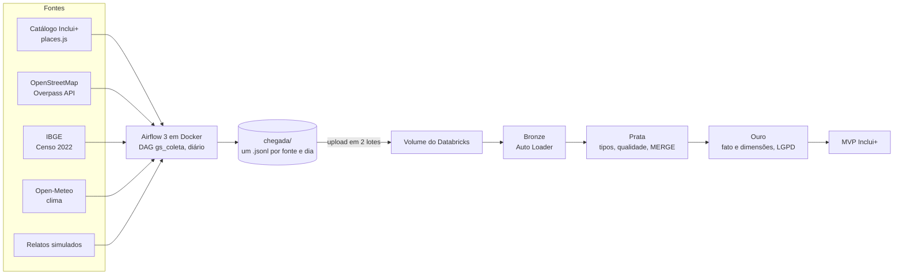

O Databricks Free Edition não se conecta ao Airflow: os arquivos de `chegada/` sobem ao Volume pela interface, em lotes.

## Fontes de dados

| Fonte (pasta em `chegada/`) | Origem | Tipo | Formato | Frequência de coleta |
| --- | --- | --- | --- | --- |
| `lugares` | `places.js` do repositório do Inclui+ (20 lugares fictícios em SP) | interna (produto) | JSONL, um lugar por linha | diária |
| `osm_acessibilidade` | OpenStreetMap via [Overpass API](https://overpass-api.de), lugares de SP com a tag `wheelchair` | **externa real** (ODbL) | JSONL, um elemento OSM por linha | diária (ao recuperar dias atrasados, reaproveita o retrato coletado nas últimas 12 h) |
| `ibge_pcd` | [API de agregados do IBGE](https://servicodados.ibge.gov.br/api/docs/agregados), tabela 10127 (Censo 2022, pessoas com deficiência por tipo, São Paulo) | **externa real** | JSONL, uma variável por linha | diária (o dado muda a cada censo) |
| `clima` | [Open-Meteo](https://open-meteo.com) (arquivo histórico), temperatura e chuva por hora nas coordenadas dos lugares | **externa real** | JSONL, um lugar por linha | diária |
| `relatos` | gerador do projeto (`src/gs_big_data/fontes/relatos.py`) | simulada e documentada | JSONL, um relato por linha | diária |

Por que cada uma está aqui:

- **Catálogo**: é a dimensão de lugares do produto (recursos de acessibilidade, bairro, coordenadas).
- **OpenStreetMap**: universo de lugares da cidade e referência independente sobre acessibilidade. Permite medir a cobertura do Inclui+.
- **IBGE**: a demanda. As dificuldades do Censo (enxergar, ouvir, andar, funções mentais) correspondem às quatro necessidades do Inclui+.
- **Open-Meteo**: chuva e calor mudam a viagem de quem usa cadeira de rodas ou bengala; permite avisar "hoje vale a pena sair?".
- **Relatos**: o MVP não tem backend e dados reais de pessoas com deficiência são sensíveis (LGPD). O gerador produz o fluxo que um backend produziria.
  É determinístico por data (reexecutar não muda o arquivo), usa as proporções do Censo para a necessidade e o catálogo para o tom do relato.
  Nome e e-mail são sintéticos (`@example.com`, domínio reservado). Cerca de 6% dos registros nascem sujos de propósito (nota inválida, lugar inexistente,
  e-mail quebrado, duplicata...) para exercitar as regras de qualidade da Prata. **Conclusões tiradas dos relatos são ilustrativas, não evidência.**

---

## 1. Coleta com Airflow (DAG `gs_coleta`)

```text
inicio -> [coletar_lugares, coletar_osm, coletar_ibge]            (em paralelo)
coletar_lugares -> [coletar_clima, gerar_relatos]                 (em paralelo)
[coletar_osm, coletar_ibge, coletar_clima, gerar_relatos] -> conferir_chegada -> notificar_resumo
```

- **Agendado**: diário, à meia-noite de Brasília, com intervalo de dados (a execução do dia D só dispara quando D termina). `max_active_runs=1`, um dia por vez.
- **Um arquivo por coleta, com a data no nome**: `chegada/<fonte>/<fonte>_<AAAA-MM-DD>.jsonl`.
- **Tarefas em paralelo** (até 3 ao mesmo tempo) e uma tarefa de conferência, `conferir_chegada`, que falha se faltar arquivo, se estiver vazio ou se houver linha que não seja JSON.
- **Idempotente**: reexecutar um dia sobrescreve o mesmo arquivo, gravado de forma atômica, com conteúdo byte a byte igual (conferido por hash).
- **Tentativas e falhas**: 2 novas tentativas por tarefa. A tarefa `coletar_osm` aparece com 2 tentativas no print abaixo: o Overpass é lento e o DAG se recuperou sozinho.
- **Notificação**: falha de qualquer tarefa e resumo final vão para o log e, se a Variable `WEBHOOK_NOTIFICACAO_SECRET` existir, para um webhook do Discord ou Slack.

| Visão do DAG (Graph) | Execução com todas as tarefas em sucesso |
| --- | --- |
| 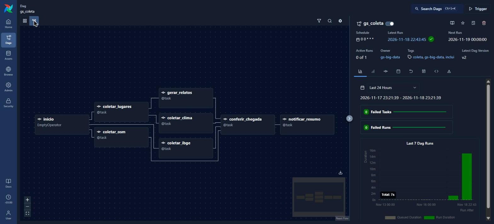 | 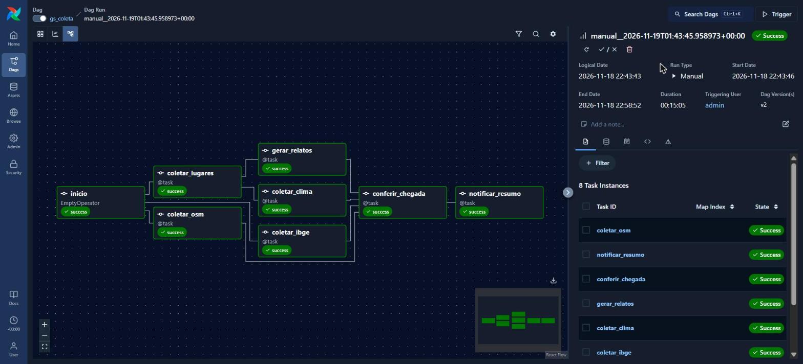 |

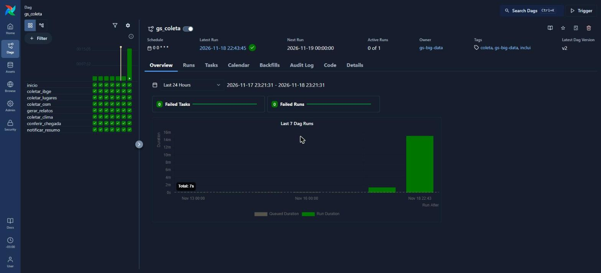

*Grid do `gs_coleta`: 7 execuções (os dias 12 a 17/11 recuperados pelo `catchup`, mais uma manual), todas em verde, sem falhas.*

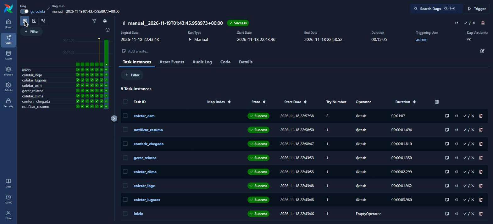

*As 8 tarefas da execução, com horário de início e duração. O OSM leva cerca de 1 minuto; o resto, poucos segundos.*

### O que a coleta gerou

| Fonte | Registros por dia | Tamanho por dia |
| --- | --- | --- |
| `lugares` | 20 | 19 KB |
| `osm_acessibilidade` | 610 (503 `yes`, 63 `limited`, 41 `no`, 3 `designated`) | 278 KB |
| `ibge_pcd` | 2 | 4 KB |
| `clima` | 20 | 20 KB |
| `relatos` | 37, 35, 39, 33 e 40 (dias 12 a 16) | 11 a 13 KB |

### Credenciais e configuração (Variables)

Nenhuma chave ou senha está no código. As Variables do Airflow vêm do `.env` (`AIRFLOW_VAR_<NOME>`) ou de *Admin > Variables*:

| Variable | Para quê | Padrão |
| --- | --- | --- |
| `WEBHOOK_NOTIFICACAO_SECRET` | URL do webhook (segredo) para avisos de falha e resumo | vazio (só log) |
| `INCLUI_PLACES_URL` | de onde ler o `places.js` | repositório do Inclui+ |
| `OVERPASS_URLS` | servidores Overpass, separados por vírgula | 3 servidores públicos |
| `OSM_REAPROVEITAR_HORAS` | janela em que um arquivo OSM de outro dia é copiado em vez de consultar o Overpass de novo (`0` = sempre consultar) | `12` |
| `TAXA_SUJEIRA_RELATOS` | parcela de relatos sujos de propósito | `0.06` |

Os nomes que terminam em `_SECRET` têm o valor mascarado na interface do Airflow. Uma variável de ambiente `AIRFLOW_VAR_*`, mesmo vazia, vence a de *Admin > Variables*: no `.env`, só descomente o que for usar.
Nenhuma das APIs usadas hoje exige chave; se a equipe incluir uma que exija (por exemplo o token da SPTrans Olho Vivo), ele entra como `AIRFLOW_VAR_SPTRANS_TOKEN`.

### Visualizando o banco do Airflow com o Adminer

O `docker compose` sobe também o **Adminer** em <http://localhost:8081> (só acessível da própria máquina), ligado ao Postgres do Airflow.
Login: sistema *PostgreSQL*, servidor `postgres`, usuário `airflow`, banco `airflow`, senha = `POSTGRES_PASSWORD` do `.env`.
Ele mostra os metadados do Airflow (DAGs, execuções, tarefas, Variables). Os dados coletados são os arquivos `.jsonl` de `chegada/`, que depois aparecem como tabelas no Databricks.

| Tabelas do banco | `dag_run`: as execuções |
| --- | --- |
| 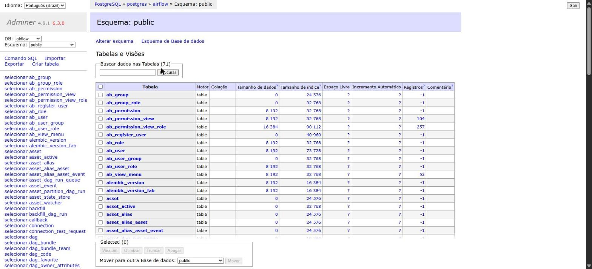 | 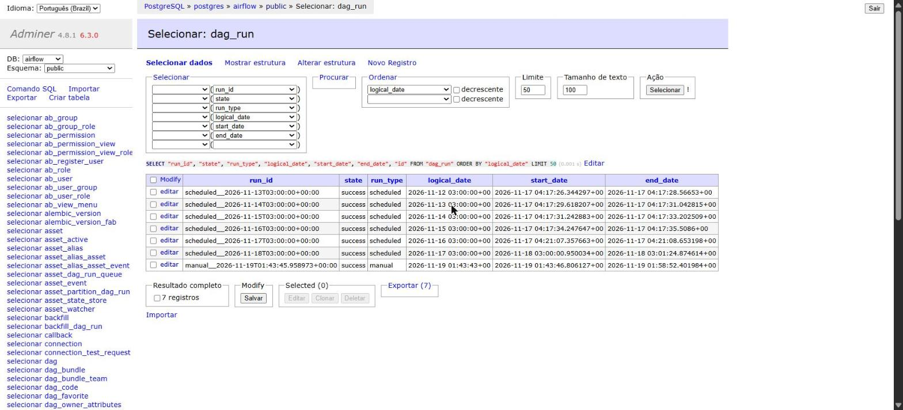 |

---

## 2. Upload para o Databricks em dois lotes

O script `python scripts/preparar_lotes.py` separa `chegada/` em `lotes/lote_1` (12, 13 e 14/11) e `lotes/lote_2` (15 e 16/11).
Cada lote sobe ao Volume `workspace.gs.chegada`, uma pasta por fonte.

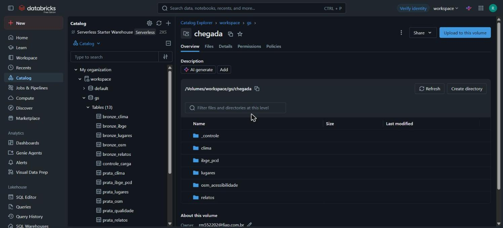

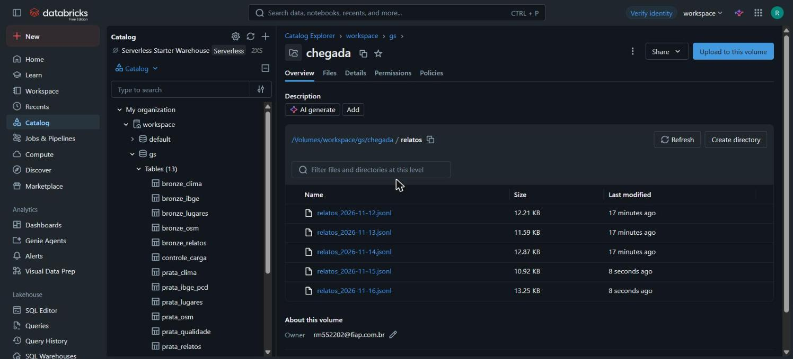

*Pasta `relatos` do Volume: os três primeiros arquivos subiram 17 minutos antes dos dois últimos, que são o 2º lote.*

## 3. Bronze: Auto Loader incremental, sem duplicar

O notebook [`01_bronze.py`](databricks/01_bronze.py) usa o **Auto Loader** (`cloudFiles`, `availableNow`) com checkpoint por fonte. O Bronze guarda o dado cru
(tudo como texto, mais `arquivo_origem` e `carregado_em`). A tabela `controle_carga` registra as contagens antes e depois de cada execução.

| Execução | bronze_lugares | bronze_osm | bronze_ibge | bronze_clima | bronze_relatos |
| --- | ---: | ---: | ---: | ---: | ---: |
| Antes do 1º lote | 0 | 0 | 0 | 0 | 0 |
| Depois do **lote 1** (3 arquivos por fonte) | 60 | 1.830 | 6 | 60 | 111 |
| Depois do **lote 2** (+2 arquivos por fonte) | 100 | 3.050 | 10 | 100 | 184 |
| **Reexecução** sem arquivo novo | 100 | 3.050 | 10 | 100 | 184 |

No lote 2 entraram só os registros novos (40, 1.220, 4, 40 e 73). Na reexecução, `novos = 0` em todas as tabelas: não há duplicação.

| Lote 1 | Lote 2 | Reexecução (novos = 0) |
| --- | --- | --- |
| 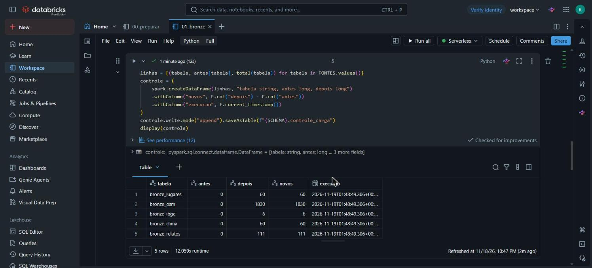 | 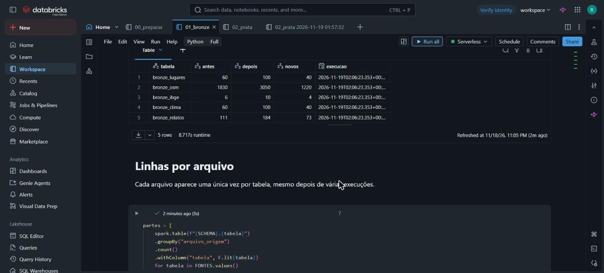 | 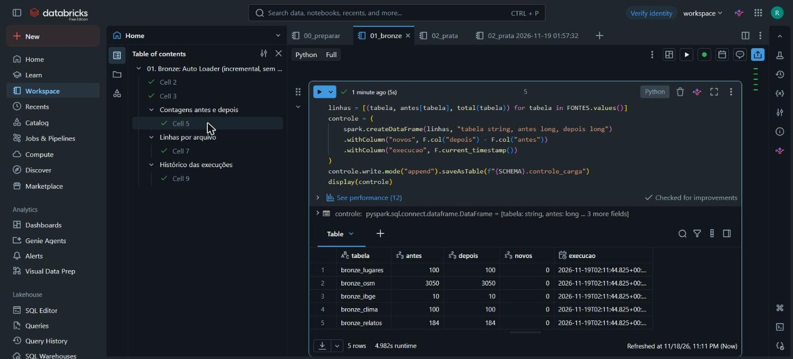 |

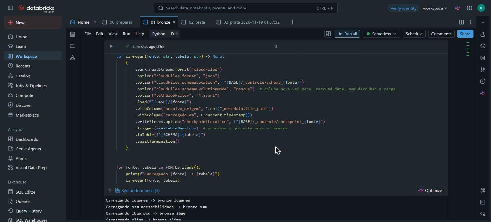

*Leitura com `cloudFiles`, checkpoint por fonte e `availableNow`: processa o que é novo e termina.*

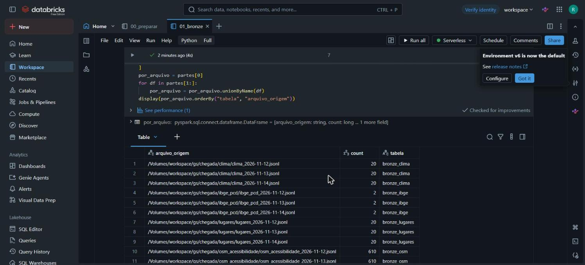

*Cada arquivo aparece uma única vez por tabela: 20 lugares, 2 linhas do IBGE, 20 de clima e 610 do OSM por dia.*

## 4. Prata: tipos, nulos, regras de qualidade e MERGE

O notebook [`02_prata.sql`](databricks/02_prata.sql) converte os tipos (`try_cast`), trata nulos, deduplica e aplica regras de qualidade com **contagem do que cada regra barrou**
(tabela `prata_qualidade`). Os registros válidos entram por `MERGE` pela chave, então rodar de novo não duplica. Os barrados dos relatos vão para `prata_relatos_quarentena`, com o motivo.
Contatos do OSM (telefone, e-mail, redes) são descartados nesta camada (LGPD).

| Regra (relatos) | Ação | Registros |
| --- | --- | ---: |
| `sem_data_hora` | barrado | 5 |
| `nota_nao_numerica` | barrado | 3 |
| `nota_fora_da_faixa` | barrado | 1 |
| `lugar_inexistente` | barrado | 1 |
| `email_invalido` | barrado | 1 |
| `necessidade_invalida` | barrado | 0 |
| `duplicado_removido` | removido | 2 |
| `necessidade_normalizada` (`"MOBILITY "` vira `mobility`) | tratado | 1 |

Essas contagens batem exatamente com os defeitos que o gerador injetou (o gabarito está no log da tarefa `gerar_relatos`). Há regras também para lugares, OSM, clima e IBGE (ver `prata_qualidade`).

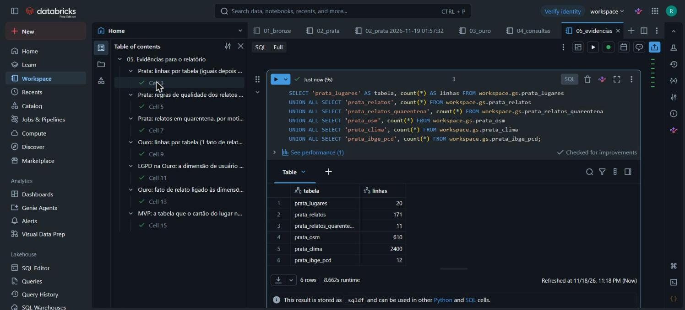

| Regras de qualidade dos relatos | Quarentena por motivo |
| --- | --- |
| 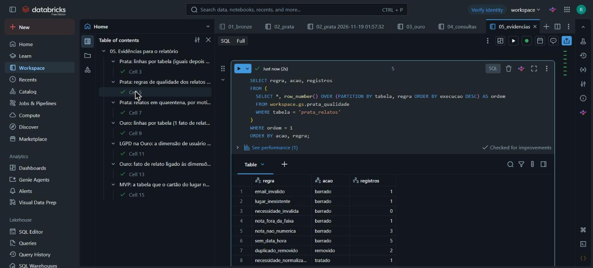 | 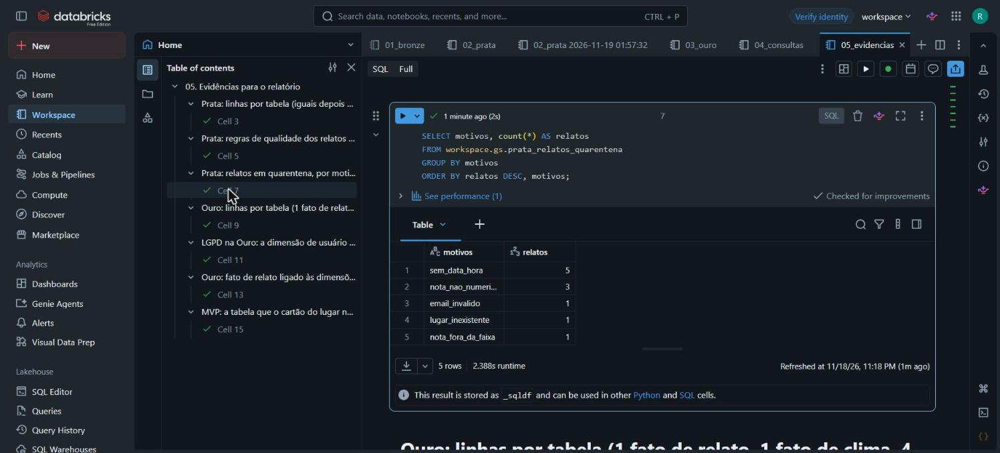 |

## 5. Ouro: modelo dimensional e LGPD

O notebook [`03_ouro.sql`](databricks/03_ouro.sql) cria **2 fatos** (`ouro_fato_relato`, `ouro_fato_clima_dia`) e **4 dimensões** (`ouro_dim_lugar`, `ouro_dim_necessidade`, `ouro_dim_tempo`, `ouro_dim_usuario`),
um agregado de cobertura do OSM e a tabela que o MVP consome, `ouro_mvp_nota_lugar` (nota média, relatos, barreiras e "o que falta" por lugar e necessidade).

**LGPD:** o nome do autor não chega à Ouro; o e-mail vira `usuario_hash` (SHA-256 com sal) e `email_mascarado` (`j***@example.com`). O sal vem de um widget do notebook e **não está no repositório**.

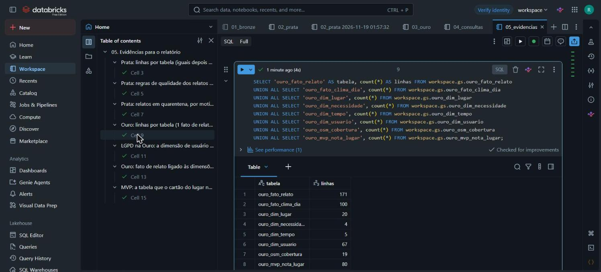

| LGPD: hash e e-mail mascarado | Fato de relato, sem dados pessoais |
| --- | --- |
| 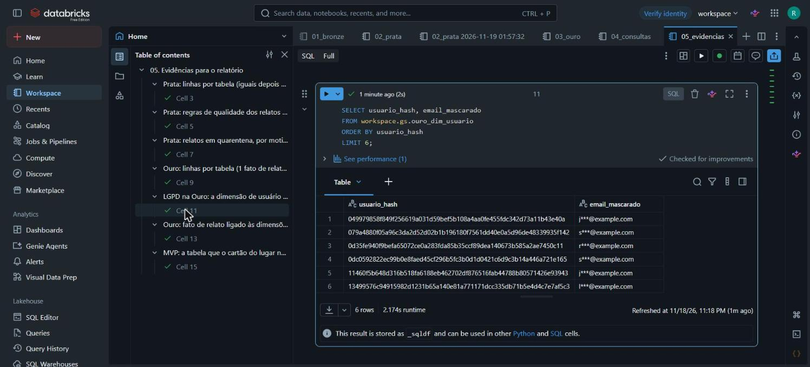 | 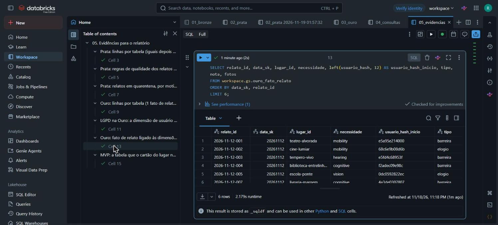 |

### MVP: a tabela que o cartão do lugar consome

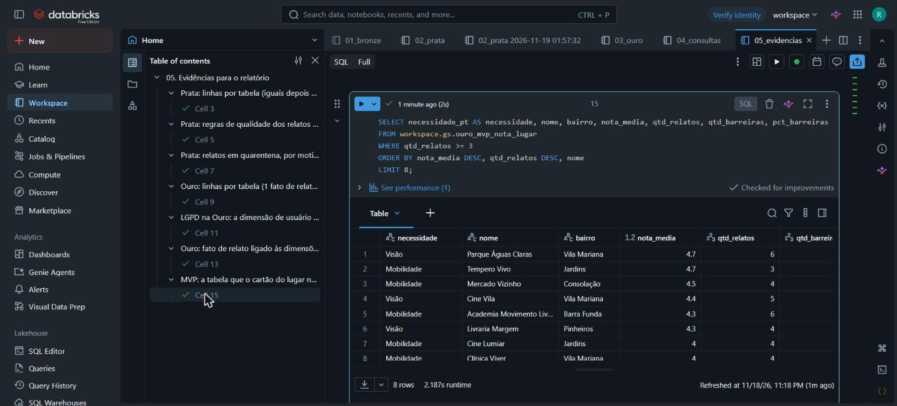

*`ouro_mvp_nota_lugar`: uma linha por lugar e necessidade. O cartão de lugar do Inclui+ lê essa tabela no lugar do `places.js`.*

**MVP no ar:** <https://d3ls3zp8wqbtsw.cloudfront.net/>


*Tela inicial do MVP: o ranking de lugares muda conforme a necessidade escolhida (mobilidade, visão, audição ou cognição). Hoje o site lê o catálogo `places.js`;
a tabela `ouro_mvp_nota_lugar` entrega a mesma estrutura (nota, relatos e barreiras por lugar e necessidade) para substituí-lo.*

## 6. As cinco consultas SQL

Todas leem a Ouro ([`04_consultas.sql`](databricks/04_consultas.sql)). Os relatos são **simulados**: as leituras abaixo ilustram o que o pipeline entrega, não são conclusões sobre a cidade.

### Consulta 1. Os 3 lugares melhor avaliados para cada necessidade
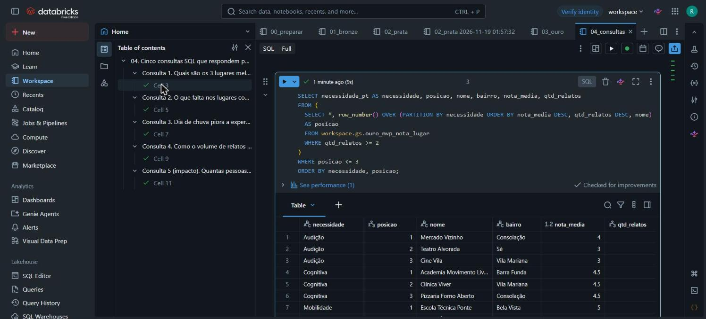

Para visão: Parque Águas Claras (4,7), Cine Vila (4,4) e Livraria Margem (4,3). Para mobilidade: Escola Técnica Ponte e Parque Águas Claras (5,0) e Tempero Vivo (4,7).
Cada nota vem de 2 a 6 relatos, então o ranking é frágil; o mínimo de 2 relatos evita nota de caso isolado.

### Consulta 2. O que falta nos lugares com barreiras para mobilidade
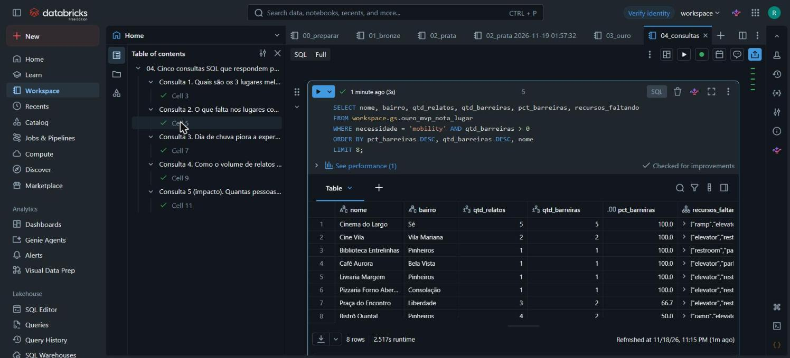

O Cinema do Largo tem 5 relatos e 5 barreiras (100%). A coluna `recursos_faltando` é a lista "o que falta" que o cartão do lugar mostra (rampa, elevador, banheiro adaptado, vaga).

### Consulta 3. Dia de chuva piora a experiência de mobilidade?
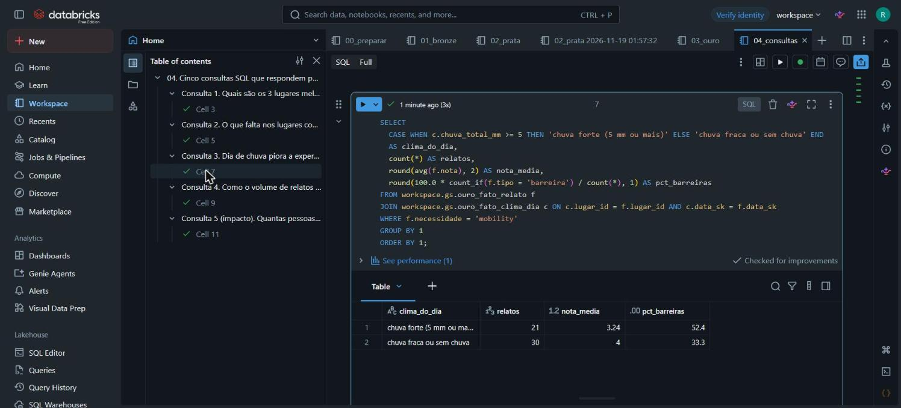

Em dias de chuva forte (5 mm ou mais): nota média 3,24 e 52,4% de relatos de barreira (21 relatos). Nos demais: nota 4,0 e 33,3% (30 relatos).
A diferença não prova causa, porque o gerador não liga chuva a barreira: reflete o mix de lugares de cada dia. A consulta mostra como cruzar clima e relato.

### Consulta 4. Como o volume e a qualidade dos relatos variam por dia
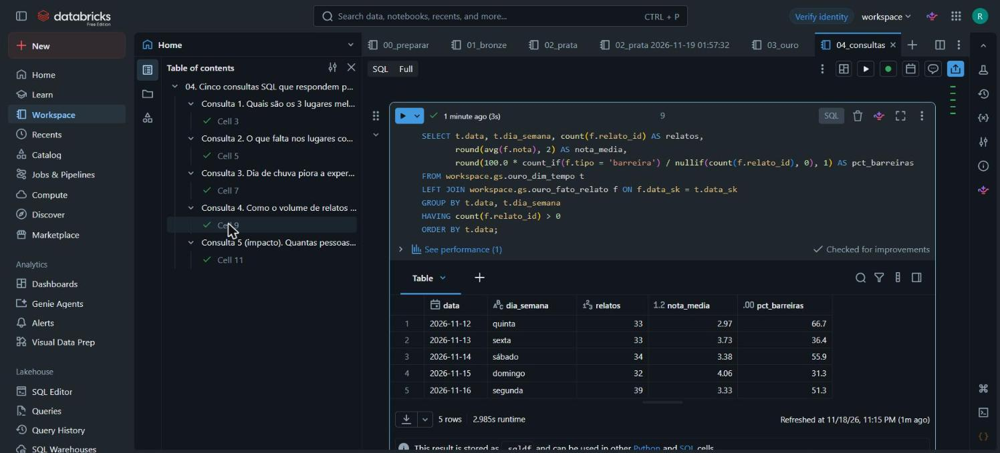

Entre 32 e 39 relatos por dia. 12/11 (quinta) teve a pior nota (2,97) e 66,7% de barreiras; 15/11 (domingo) teve a melhor (4,06) e 31,3%.

### Consulta 5 (impacto). Quantas pessoas dependem de cada lugar bem avaliado?
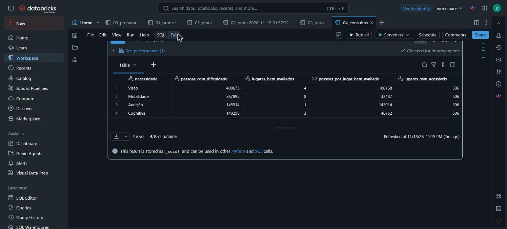

Cruza o Censo 2022 (IBGE) com a oferta do Inclui+ e com o OSM:

| Necessidade | Pessoas com dificuldade (SP) | Lugares bem avaliados | Pessoas por lugar bem avaliado |
| --- | ---: | ---: | ---: |
| Visão | 400.673 | 4 | 100.168 |
| Mobilidade | 267.895 | 8 | 33.487 |
| Audição | 145.914 | 1 | 145.914 |
| Cognitiva | 140.256 | 3 | 46.752 |

O OSM tem 506 lugares acessíveis mapeados e o Inclui+ cobre 20 dos 610 (3,3%). A lacuna a atacar é **audição e visão**, além de expandir o catálogo.
O SQL completo está em [`06f_consulta5_impacto_sql.jpg`](prints/06_consultas/06f_consulta5_impacto_sql.jpg).

---

## Rubrica do enunciado × onde está a evidência

| # | Requisito | Onde ver |
| --- | --- | --- |
| 01 | DAG agendada, um arquivo por coleta com data no nome em `chegada/` | [`dags/gs_coleta.py`](dags/gs_coleta.py), `prints/01_airflow_e_adminer` |
| 02 | Mais de 2 tarefas em paralelo e tarefa de conferência | Graph (`01b`, `01c`): 3 coletas em paralelo, `conferir_chegada` |
| 03 | Chaves em Variables e notificação | Seção "Credenciais e configuração"; `src/gs_big_data/notifica.py` |
| 04 | Upload em 2 lotes de dias diferentes | `prints/02_databricks_volume` |
| 05 | Bronze incremental sem duplicar | `prints/03_bronze` (lote 1, lote 2 e `novos = 0`) |
| 06 | Prata com tipos, nulos, MERGE e 3+ regras com contagem | `prints/04_prata`, [`02_prata.sql`](databricks/02_prata.sql) |
| 07 | Ouro com 1 fato, 2+ dimensões e 5 consultas (1 de impacto) | `prints/05_ouro`, `prints/06_consultas` |
| 08 | LGPD (hash e máscara) | `prints/05_ouro/05b` e `05c` |
| 09 | MVP com tabela da Ouro e README | `prints/05_ouro/05d`, `prints/07_github`, este arquivo |

## Como reproduzir

Pré-requisitos: Docker Desktop em execução (a pilha usa cerca de 2 GB de RAM; o Docker precisa de pelo menos 4 GB) e Python 3, só para gerar o `.env`.

```bash
python scripts/gerar_env.py        # cria o .env com segredos aleatórios (não vai para o Git)
docker compose build               # constrói a imagem gs-big-data/airflow (3 GB; a 1ª vez leva alguns minutos)
docker compose up -d               # sobe Postgres, Airflow (api-server, scheduler, dag-processor) e Adminer
```

1. Abra <http://localhost:8080>. Usuário e senha estão em `_AIRFLOW_WWW_USER_*` no `.env`.
2. O DAG `gs_coleta` já nasce ativo. Por causa do `catchup`, ele recupera sozinho cada dia desde 12/11/2026, um de cada vez.
3. Os arquivos aparecem em `chegada/<fonte>/<fonte>_<AAAA-MM-DD>.jsonl`.
4. Para reexecutar um dia (por exemplo 14/11): `docker compose exec airflow-scheduler airflow tasks clear gs_coleta --start-date 2026-11-14T00:00:00-03:00 --end-date 2026-11-14T23:00:00-03:00 -y`.
5. Para parar: `docker compose down` (acrescente `-v` para apagar também o banco do Airflow).

No Databricks, o passo a passo está em [databricks/README.md](databricks/README.md). Testes da lógica de coleta (sem rede):

```bash
docker compose run --rm airflow-cli python -m unittest discover -s tests -t .
```

## Estrutura

```text
dags/            DAGs do Airflow (gs_coleta.py)
src/gs_big_data/ código da coleta (um módulo por fonte, em fontes/)
tests/           testes unitários
chegada/         pasta de pouso (conteúdo fora do Git)
amostras/        um pouco de cada fonte
scripts/         gerar_env.py e preparar_lotes.py
databricks/      notebooks Bronze, Prata, Ouro, consultas e evidências (ver databricks/README.md)
prints/          evidências por etapa (Airflow, Volume, Bronze, Prata, Ouro, consultas)
relatorio/       modelo do relatório em Word (preencher e exportar para PDF)
lotes/           lotes de arquivos para subir ao Databricks (gerados; fora do Git)
Dockerfile, docker-compose.yaml, requirements.txt, .env.example
```

## Um problema real que apareceu só no Databricks

O primeiro teste da Prata no Databricks falhou com `Can't extract a value from "entrance"`. O Auto Loader, sem `inferColumnTypes`, guarda objetos e listas do JSON
**como texto**, enquanto o teste local em Spark lia como estruturas. A correção foi interpretar essas colunas com `from_json` na Prata (`entrance`, `features`, `tags`, `center`, `hourly`, `resultados`),
e o teste local passou a simular a Bronze em texto para não esconder o problema de novo.

## LGPD

- Nada de dado pessoal real: autores dos relatos são sintéticos (`example.com`).
- Na Ouro, `autor_email` vira hash com sal (o sal fica fora do repositório) e `autor_nome` não entra.
- Os elementos do OSM podem trazer telefone e e-mail de estabelecimentos. Eles ficam só no arquivo bruto de `chegada/` (fora do Git) e são descartados na Prata; as `amostras/` só têm elementos sem esses campos.
- O `.env` está no `.gitignore`; o repositório não contém chaves, senhas ou tokens.
- Os prints foram conferidos: nenhum mostra o sal, senha ou token.

## O que ainda falta

1. Mostrar no MVP a tabela da Ouro que ele consome (`ouro_mvp_nota_lugar`): exportar como JSON e usar no lugar de `PLACES`.
2. Print da tela *Admin > Variables* do Airflow, depois de criar `WEBHOOK_NOTIFICACAO_SECRET` com um webhook de teste (isso também gera o print da notificação).
3. Conferir o relatório em [`relatorio/`](relatorio/), exportar para PDF com o link deste repositório e enviar pelo Teams até 19/11/2026, 23h55.
