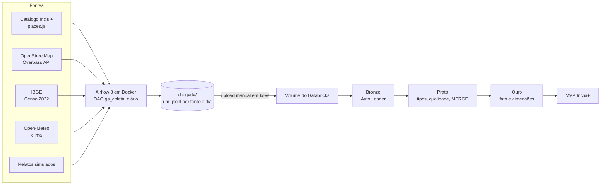

# GS Big Data: pipeline de dados do Inclui+

Componente **Big Data & Data Integration** da Global Solution FIAP 2026.2 (CitizenTech, 4º ano de Engenharia de Software).
Produto da equipe: **Inclui+**, um guia de lugares acessíveis em São Paulo com nota por necessidade
(mobilidade, visão, audição e cognitiva). Repositório do MVP: <https://github.com/kaikyalvaro1708/inclui-gs>.

Este repositório coleta os dados do problema com o **Airflow 3 em Docker**, grava um arquivo por coleta na pasta
`chegada/` e, daí em diante, o lakehouse do Databricks trata em camadas Bronze, Prata e Ouro para alimentar o MVP.

## Integrantes

| Nome completo | RM |
| --- | --- |
| _preencher_ | _preencher_ |

## Arquitetura



O Databricks Free Edition não se conecta ao Airflow: os arquivos de `chegada/` sobem ao Volume pela interface, em lotes.

## Fontes de dados

| Fonte (pasta em `chegada/`) | Origem | Tipo | Formato | Frequência de coleta |
| --- | --- | --- | --- | --- |
| `lugares` | `places.js` do repositório do Inclui+ (20 lugares fictícios em SP) | interna (produto) | JSONL, um lugar por linha | diária |
| `osm_acessibilidade` | OpenStreetMap via [Overpass API](https://overpass-api.de), lugares de SP com a tag `wheelchair` | **externa real** (ODbL) | JSONL, um elemento OSM por linha | diária (ao recuperar dias atrasados, reaproveita o retrato coletado nas últimas 12 h) |
| `ibge_pcd` | [API de agregados do IBGE](https://servicodados.ibge.gov.br/api/docs/agregados), tabela 10127 (Censo 2022, pessoas com deficiência por tipo, São Paulo) | **externa real** | JSONL, uma variável por linha | diária (o dado muda a cada censo) |
| `clima` | [Open-Meteo](https://open-meteo.com) (arquivo histórico), temperatura e chuva por hora nas coordenadas dos lugares | **externa real** | JSONL, um lugar por linha | diária |
| `relatos` | gerador do projeto (`src/gs_big_data/fontes/relatos.py`) | simulada e documentada | JSONL, um relato por linha | diária |

Por que cada uma está aqui:

- **Catálogo**: é a dimensão de lugares do produto (recursos de acessibilidade, bairro, coordenadas).
- **OpenStreetMap**: universo de lugares da cidade e referência independente sobre acessibilidade. Permite medir a cobertura do Inclui+.
- **IBGE**: a demanda. As dificuldades do Censo (enxergar, ouvir, andar, funções mentais) correspondem às quatro necessidades do Inclui+.
- **Open-Meteo**: chuva e calor mudam a viagem de quem usa cadeira de rodas ou bengala; permite avisar "hoje vale a pena sair?".
- **Relatos**: o MVP não tem backend e dados reais de pessoas com deficiência são sensíveis (LGPD). O gerador produz o fluxo que um backend produziria.
  É determinístico por data (reexecutar não muda o arquivo), usa as proporções do Censo para a necessidade e o catálogo para o tom do relato.
  Nome e e-mail são sintéticos (`@example.com`, domínio reservado). Cerca de 6% dos registros nascem sujos de propósito (nota inválida, lugar inexistente,
  e-mail quebrado, duplicata...) para exercitar as regras de qualidade da Prata. A contagem de cada defeito aparece no log da tarefa `gerar_relatos`.
  **Conclusões tiradas dos relatos são ilustrativas, não evidência.**

## Como reproduzir

Pré-requisitos: Docker Desktop em execução (a pilha usa cerca de 2 GB de RAM; o Docker precisa de pelo menos 4 GB) e Python 3, só para gerar o `.env`.

```bash
python scripts/gerar_env.py        # cria o .env com segredos aleatórios (não vai para o Git)
docker compose build               # constrói a imagem gs-big-data/airflow (3 GB; a 1ª vez leva alguns minutos)
docker compose up -d               # sobe Postgres, api-server, scheduler e dag-processor
```

1. Abra <http://localhost:8080>. Usuário e senha estão em `_AIRFLOW_WWW_USER_*` no `.env`.
2. O DAG `gs_coleta` já nasce ativo. Por causa do `catchup`, ele recupera sozinho cada dia desde 12/11/2026, um de cada vez (5 dias levam cerca de 2 minutos).
3. Os arquivos aparecem em `chegada/<fonte>/<fonte>_<AAAA-MM-DD>.jsonl`.
4. Para reexecutar um dia (por exemplo 14/11): `docker compose exec airflow-scheduler airflow tasks clear gs_coleta --start-date 2026-11-14T00:00:00-03:00 --end-date 2026-11-14T23:00:00-03:00 -y`.
5. Para parar: `docker compose down` (acrescente `-v` para apagar também o banco do Airflow).

Testes da lógica de coleta (sem rede):

```bash
docker compose run --rm airflow-cli python -m unittest discover -s tests -t .
```

### O DAG `gs_coleta`

```text
inicio -> [coletar_lugares, coletar_osm, coletar_ibge]            (em paralelo)
coletar_lugares -> [coletar_clima, gerar_relatos]                 (em paralelo)
[coletar_osm, coletar_ibge, coletar_clima, gerar_relatos] -> conferir_chegada -> notificar_resumo
```

- **Agendado**: diário, à meia-noite de Brasília, com intervalo de dados: a execução do dia D só dispara quando D termina, então cada arquivo cobre um dia completo. `max_active_runs=1` (um dia por vez, gentil com as APIs públicas).
- **Idempotente**: reexecutar um dia sobrescreve o mesmo arquivo, gravado de forma atômica (sem arquivo pela metade), e o conteúdo sai byte a byte igual (conferido por hash).
- **Conferência**: `conferir_chegada` falha se faltar arquivo, se estiver vazio ou se alguma linha não for JSON válido.
- **Notificação**: falha de qualquer tarefa e resumo ao final vão para o log e, se `WEBHOOK_NOTIFICACAO_SECRET` estiver definida, para um webhook do Discord ou Slack.
- **Tentativas**: 2 novas tentativas por tarefa; o Overpass ainda tenta três servidores espelho.

### O que a primeira execução gerou (dias 12 a 16/11/2026)

| Fonte | Registros por dia | Tamanho por dia |
| --- | --- | --- |
| `lugares` | 20 | 19 KB |
| `osm_acessibilidade` | 610 (503 `yes`, 63 `limited`, 41 `no`, 3 `designated`) | 278 KB |
| `ibge_pcd` | 2 | 4 KB |
| `clima` | 20 | 20 KB |
| `relatos` | 37, 35, 39, 33 e 40 | 11 a 13 KB |

São 25 arquivos. Os lotes para o Databricks podem ser, por exemplo, os dias 12 a 14 e depois 15 e 16.

### Credenciais e configuração (Variables)

Nenhuma chave ou senha está no código. Variables do Airflow podem vir do `.env` (`AIRFLOW_VAR_<NOME>`) ou de *Admin > Variables*:

| Variable | Para quê | Padrão |
| --- | --- | --- |
| `WEBHOOK_NOTIFICACAO_SECRET` | URL do webhook (segredo) para avisos de falha e resumo | vazio (só log) |
| `INCLUI_PLACES_URL` | de onde ler o `places.js` | repositório do Inclui+ |
| `OVERPASS_URLS` | servidores Overpass, separados por vírgula | 3 servidores públicos |
| `OSM_REAPROVEITAR_HORAS` | janela em que um arquivo OSM de outro dia é copiado em vez de consultar o Overpass de novo (`0` = sempre consultar) | `12` |
| `TAXA_SUJEIRA_RELATOS` | parcela de relatos sujos de propósito | `0.06` |

Os nomes que terminam em `_SECRET` têm o valor mascarado na interface do Airflow. Uma variável de ambiente `AIRFLOW_VAR_*`, mesmo vazia, vence a de *Admin > Variables*: no `.env`, só descomente o que for usar.
Nenhuma das APIs usadas hoje exige chave. Se a equipe incluir uma que exija (por exemplo o token da SPTrans Olho Vivo), ele entra como `AIRFLOW_VAR_SPTRANS_TOKEN` no `.env`.

## Estrutura

```text
dags/            DAGs do Airflow (gs_coleta.py)
src/gs_big_data/ código da coleta (um módulo por fonte, em fontes/)
tests/           testes unitários
chegada/         pasta de pouso (conteúdo fora do Git)
amostras/        um pouco de cada fonte
scripts/         gerar_env.py
Dockerfile, docker-compose.yaml, requirements.txt, .env.example
relatorio/       modelo do relatório em Word (preencher e exportar para PDF)
databricks/      notebooks Bronze, Prata, Ouro e consultas (ver databricks/README.md)
lotes/           lotes de arquivos para subir ao Databricks (gerados por scripts/preparar_lotes.py; fora do Git)
```

## LGPD

- Nada de dado pessoal real: autores dos relatos são sintéticos (`example.com`).
- Na Ouro, `autor_email` vira hash com sal (o sal fica fora do repositório) e `autor_nome` não entra.
- Os elementos do OSM podem trazer telefone e e-mail de estabelecimentos (245 de 610 na primeira carga). Eles ficam no arquivo bruto de `chegada/` (fora do Git) e devem ser descartados na Prata; as `amostras/` só têm elementos sem esses campos.
- O `.env` está no `.gitignore`; o repositório não contém chaves, senhas ou tokens.

## Próximas etapas

Os notebooks já estão em `databricks/` (passo a passo em [databricks/README.md](databricks/README.md)). Falta executá-los no Databricks Free Edition:

1. Subir os arquivos em dois lotes (`python scripts/preparar_lotes.py`) e rodar Bronze e Prata a cada lote.
2. Rodar Ouro e as cinco consultas, e tirar os prints para o relatório.
3. Mostrar no MVP a tabela da Ouro que ele consome (`ouro_mvp_nota_lugar`).
4. Preencher integrantes (nome completo e RM) aqui e no relatório.
